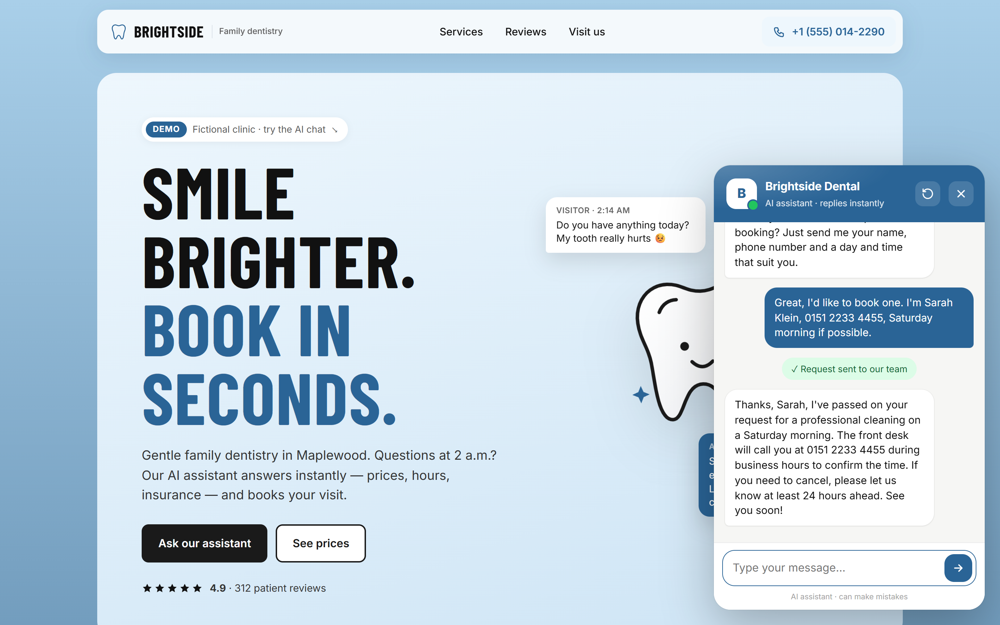
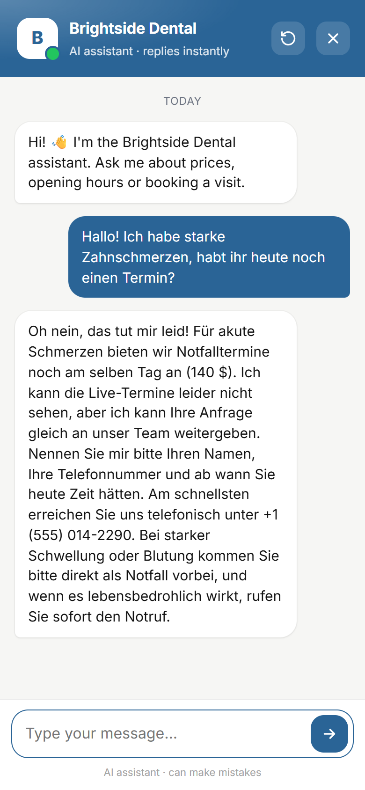

# AI Chat Assistant for Small-Business Websites

A chat widget that answers visitors' questions 24/7 from the business's own information and turns conversations into booking requests. Demo business: **Brightside Dental** (fictional clinic).

| Booking a visit in the chat | On a phone, in German |
|---|---|
|  |  |

More screenshots: [demo site](docs/01-site-desktop.png) · [prices & hours answer](docs/02-chat-prices.png). Leads flow on into the [lead automation demo](https://github.com/khramik/n8n-lead-automation-demo) (Google Sheet, owner email, follow-up reminders).

## What it does
- **Answers instantly**: prices, opening hours, location, insurance, policies. It only uses the business's own knowledge base (`business.md`) and doesn't invent anything.
- **Captures leads**: collects name, phone, preferred time and reason, then saves the request. The visitor sees a confirmation.
- **Sends leads anywhere (optional)**: every new lead can be POSTed to an n8n / Make / Zapier webhook → Google Sheets, CRM, email or Slack.
- **Speaks the visitor's language** (English, German, Spanish, …).
- **One line to install** on any website (WordPress, Wix, Webflow, Shopify, plain HTML).
- **Mobile-friendly**: full-screen chat on phones, keyboard and screen-reader accessible.
- **Safe by default**: input limits, per-visitor rate limit, allowed-origins list, API key kept on the server only.

## Install on a website
```html
<script src="https://YOUR-SERVER/widget.js" defer
  data-title="Your Business"
  data-color="#0f766e"
  data-greeting="Hi! How can I help?"
  data-suggestions="Prices|Opening hours|Book a visit"></script>
```

## Run locally
Requires Node.js 20+.
```bash
npm install
cp .env.example .env     # add your ANTHROPIC_API_KEY (optional, see below)
npm start                # → http://localhost:3000
npm test
```
Without an API key the server runs in **demo mode** with simple keyword answers, so the widget can be previewed without AI costs.

## Configuration (`.env`)
| Variable | Purpose |
|---|---|
| `ANTHROPIC_API_KEY` | Claude API key. Empty = demo mode |
| `MODEL` / `EFFORT` | Which Claude model answers, and how much it thinks (`low` is enough for chat) |
| `LEAD_WEBHOOK_URL` | Optional automation webhook for new leads |
| `ALLOWED_ORIGINS` | Websites allowed to embed the widget |
| `RATE_LIMIT_PER_MINUTE` | Spam protection per visitor |

## Adapting it for a new business
1. Replace `business.md` with the client's services, prices, hours and policies.
2. Set the widget title, color, greeting and quick buttons in the `<script>` tag.
3. Deploy the server (any small VPS or Node host) and paste the script tag into the site.

## Tech
Node.js (no framework), Claude API via the official `@anthropic-ai/sdk` with streaming replies and tool use for lead capture, vanilla JS widget in Shadow DOM (no style conflicts with the host site).

## Project structure
```
server.js          HTTP server: static files, /api/chat (streaming), rate limit, CORS
business.md        knowledge base: the only file to edit per client
lib/ai.js          Claude integration + save_lead tool
lib/leads.js       saves leads to data/leads.json and the optional webhook
lib/validate.js    input validation
lib/demo.js        keyword answers for demo mode
public/widget.js   the embeddable chat widget
public/index.html  demo website
```
